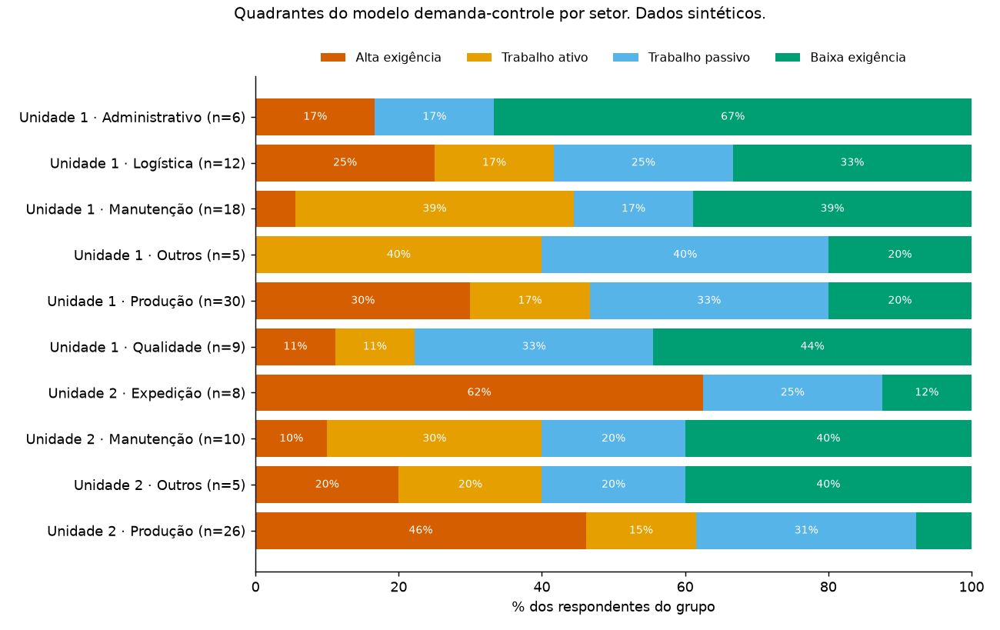
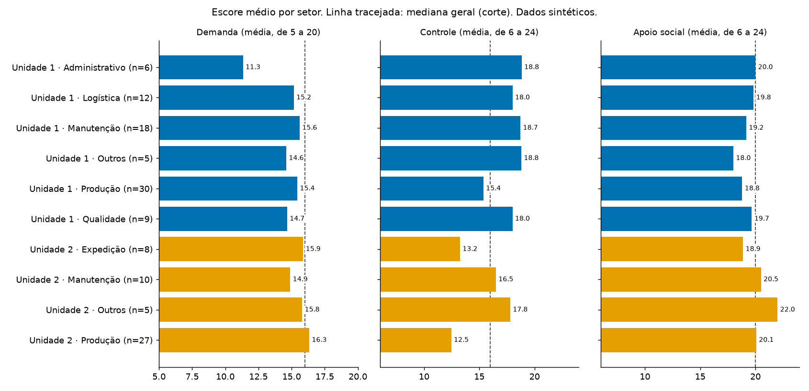

# Estresse no Trabalho por Setor (Job Stress Scale)

**English summary.** Portfolio project: how job demand, control and social support (short Job Stress Scale, Brazilian Portuguese version by Alves et al., 2004) are distributed across departments and two sites of a company, and where the high-strain groups are. **All data in this repository is synthetic**, generated by a seeded script; no real answers are published. The pipeline covers cleaning and anonymisation, scoring (with reversed items), Karasek's demand-control quadrants, Cronbach's alpha, a Mann-Whitney comparison with effect size, bar charts and an HTML report. Python, pandas, SciPy, matplotlib, pytest.

## A pergunta

Como demanda, controle e apoio social no trabalho se distribuem entre setores e entre duas unidades de uma empresa, e onde estão os grupos de maior risco psicossocial?

## Os dados são fictícios

Todas as respostas deste repositório são **sintéticas**: foram geradas por `scripts/gerar_dados.py`, com semente fixa. Setores, tamanhos e tendências foram inventados. Nenhuma resposta de pessoa real está aqui, e **os números abaixo não descrevem nenhuma empresa**: eles mostram o método funcionando do começo ao fim.

O texto das 17 perguntas do questionário **não é reproduzido**. As colunas se chamam `q01` a `q17`. O instrumento é a versão resumida da Job Stress Scale adaptada para o português:

> Alves MGM, Chor D, Faerstein E, Lopes CS, Werneck GL. Versão resumida da "job stress scale": adaptação para o português. Rev Saúde Pública. 2004;38(2):164-171. https://doi.org/10.1590/S0034-89102004000200003

## O caminho dos dados

| Etapa | Comando | O que faz |
|---|---|---|
| 1. Limpeza | `python scripts/limpar.py` | Remove ID, horários e e-mail na leitura; padroniza textos; confere as 17 perguntas; junta setores com menos de 5 pessoas em "Outros" |
| 2. Pontuação | (módulo `src/jss/pontuacao.py`) | Respostas viram 1 a 4 pontos; `q04` e `q09` são invertidos; cada dimensão é a soma dos itens |
| 3. Análise | `python scripts/analisar.py` | Quadrantes do modelo demanda-controle, apoio alto ou baixo, alfa de Cronbach, descritivos e comparação entre unidades |
| 4. Relatório | `python scripts/gerar_relatorio.py` | Monta `resultados/relatorio.html` |

O método de pontuação, com a fonte de cada regra, está em [docs/METODO.md](docs/METODO.md).

## Resultados com os dados fictícios

Gerados em 11/11/2026 por `python scripts/analisar.py` (semente 20261111). Tabelas completas em `resultados/`; relatório em [resultados/relatorio.html](resultados/relatorio.html); passo a passo em [analise.ipynb](analise.ipynb).

- **130 respondentes** (80 na Unidade 1 e 50 na Unidade 2). 4 setores pequenos, com 10 pessoas ao todo, foram agrupados em "Outros". Uma pessoa deixou um item de controle em branco e ficou sem quadrante.
- **Consistência interna (alfa de Cronbach):** 0,81 na demanda, 0,87 no controle e 0,80 no apoio social (`resultados/alfas.csv`).
- **Quadrantes** (corte na mediana geral: demanda 16, controle 16): 34 pessoas em alta exigência (26% de 129), 25 em trabalho ativo, 35 em trabalho passivo e 35 em baixa exigência (`resultados/resumo.json`).
- **Onde a alta exigência se concentra:** Expedição da Unidade 2 (5 de 8 pessoas, 62%) e Produção da Unidade 2 (12 de 26, 46%) (`resultados/quadrantes_por_setor.csv`).
- **Entre unidades:** o controle é menor na Unidade 2 (mediana 15,0 contra 17,5; Mann-Whitney U = 2715,5; p = 0,0002; efeito r = 0,39). Em demanda (p = 0,12; r = −0,16) e apoio (p = 0,06; r = −0,19) a diferença não é clara com esta amostra (`resultados/comparacao.csv`).





## Cuidados de anonimização

- ID, horários de início e conclusão, e-mail e nome são descartados **na leitura** do arquivo: nunca entram na tabela.
- Empresa sem nome; unidades viram "Unidade 1" e "Unidade 2".
- Setor com menos de 5 respondentes vira "Outros"; a análise se recusa a mostrar grupo menor que 5.
- As linhas são embaralhadas, porque a ordem original segue o horário da resposta.
- Nenhum gráfico usa coluna de horário.
- Dados reais, quando usados, ficam em `data/raw/` e `data/privado/`, que o git ignora.

## Como reproduzir

```bash
pip install -r requirements.txt
python scripts/gerar_dados.py      # recria data/sintetico/
python scripts/limpar.py           # recria data/limpo/
python scripts/analisar.py         # recria resultados/ (tabelas e gráficos)
python scripts/gerar_relatorio.py  # recria resultados/relatorio.html
python -m pytest -q
```

Para abrir o caderno: `pip install notebook` e `jupyter notebook analise.ipynb`.

## Estrutura

- `src/jss/`: `limpeza.py`, `pontuacao.py`, `analise.py`, `graficos.py` e `sintetico.py` (gerador dos dados fictícios).
- `scripts/`: os comandos acima.
- `data/sintetico/`: entrada fictícia, bagunçada de propósito. `data/limpo/`: saída da limpeza.
- `resultados/`: tabelas, gráficos e relatório.
- `tests/`: testes da limpeza, da pontuação (incluindo itens invertidos), da análise e do relatório.
- `docs/`: [COMO-FUNCIONA.md](docs/COMO-FUNCIONA.md), [METODO.md](docs/METODO.md), [DECISOES.md](docs/DECISOES.md), [ESTUDO.md](docs/ESTUDO.md) e [INTERPRETACAO.md](docs/INTERPRETACAO.md).

## Limitações

- **Dados sintéticos:** servem para mostrar o método, não para concluir nada sobre trabalhadores reais. As diferenças entre setores existem porque foram colocadas no gerador.
- **Autorrelato e recorte transversal:** a escala mede percepção num momento; não mostra causa.
- **Amostra pequena:** em grupos de 5 a 10 pessoas, uma ou duas respostas mudam o percentual.
- **Rastreamento, não diagnóstico:** a escala aponta onde olhar; não diagnostica pessoas.
- **Corte pela mediana:** "alto" e "baixo" são relativos ao próprio grupo.
- **Redação do formulário:** a quarta opção de apoio social aparece como "Discordo", e não "Discordo totalmente" como no artigo.
